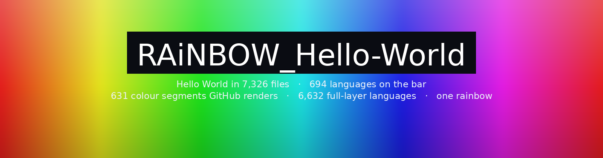
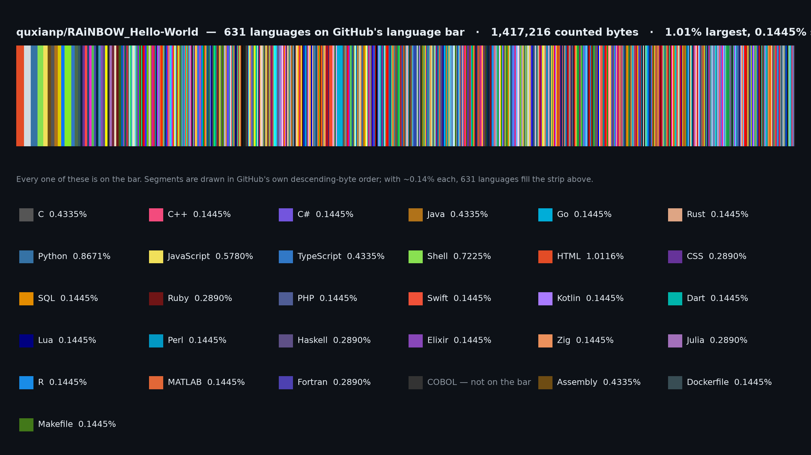
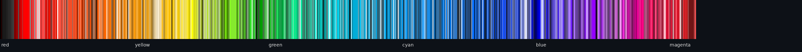
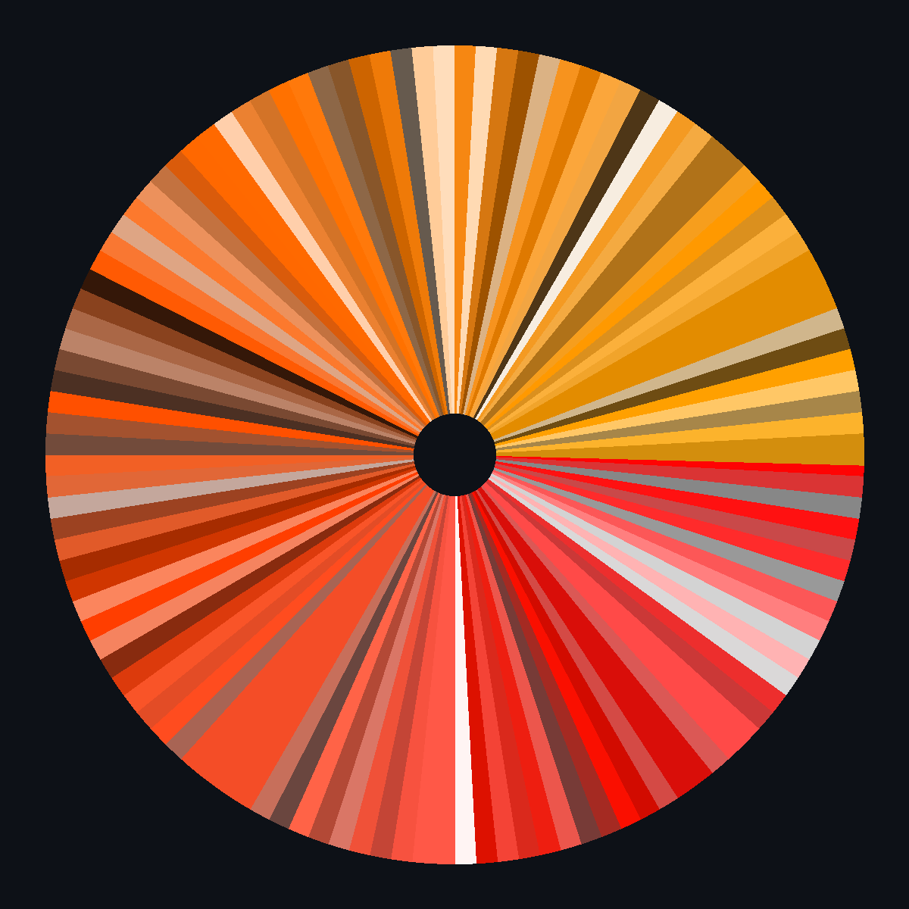

<div align="center">



# RAiNBOW_Hello-World

**Hello World, in 7 326 files — and a GitHub language bar that is a rainbow.**

[](https://github.com/quxianp/RAiNBOW_Hello-World)
[](https://github.com/quxianp/RAiNBOW_Hello-World)
[](https://github.com/quxianp/RAiNBOW_Hello-World)
[](https://github.com/quxianp/RAiNBOW_Hello-World)
[](https://github.com/quxianp/RAiNBOW_Hello-World)
[](https://github.com/quxianp/RAiNBOW_Hello-World/actions)

</div>

---

<div align="center">

**Contents**

[🎬 The show](#-the-show) ·
[🌈 How the rainbow is engineered](#how-the-rainbow-is-engineered) ·
[🗂️ Where the 7 325 languages came from](#where-the-7-325-languages-came-from) ·
[▶️ Running it](#running-it) ·
[✅ Acceptance checks](#acceptance-checks) ·
[🧱 Layout](#layout) ·
[📎 Dependencies and fallbacks](#dependencies-and-fallbacks) ·
[🎓 Acknowledgements](#acknowledgements)

</div>

---

GitHub colours every repository by the byte share of each language it detects.
This repository is built around one idea: put **every single language GitHub
Linguist knows how to colour** into the bar, give each of them an *identical*
slice of the pie, and order them by hue. The result is the densest, most
continuous language bar on GitHub — hundreds of hair-thin segments sweeping
through red, orange, amber, yellow, chartreuse, green, cyan, azure, blue,
violet, magenta and back to red.

| | |
|---|---|
| Core layer (`hello/core/`) | **694** languages — every Linguist-coloured language that can be detected |
| Full layer (`hello/full/`) | **6 632** files — the long tail of every language we could find |
| Total language files | **7 326** |
| Merged inventory | **7 325** unique language records |
| Byte share per core language | **0.144092 %** (exactly equal for all 694) |
| Share sum | **100.000000 %** |
| Segments GitHub renders | **631** (Linguist folds some dialect names together — see [why](#7-why-you-cannot-see-c-and-c-named-on-the-site)) |

Everything heavy — compiling, running, recording, screenshotting and committing
the demo assets back into this repository — happens in **GitHub Actions**, not
on your machine.

---

<!-- RAINBOW_ASSETS_START -->

## 🎬 The show

<div align="center">

<table>
<tr>
<td width="50%" valign="top">



<br><sub><b>All 631 languages.</b><br>Drawn from <code>GET /repos/&#8230;/languages</code>—the breakdown GitHub itself serves.</sub>

</td>
<td width="50%" valign="top">



<br><sub><b>The hue sweep.</b><br>694 Linguist colours, ordered by hue.</sub>

</td>
</tr>
</table>

</div>

<div align="center">


<br><sub>⬇↓ <a href="assets/hello-world.mp4">Download the MP4</a> — <code>run.sh</code> recorded with VHS in GitHub Actions.</sub>

</div>

> **Why the bar is drawn rather than screenshotted.** GitHub's own legend can
> only name the largest handful of languages and collapses the remaining 600+
> into a single grey <b>Other</b> row, so C and C++ never appear by name on the
> site no matter how this repository is built. The bar itself does contain them
> — 631 hair-thin segments — but the legend will not say so, which is why both
> images above are generated from the JSON GitHub itself serves.

<!-- RAINBOW_ASSETS_END -->

---

## How the rainbow is engineered

### 1. Two layers, because Linguist is the ceiling

GitHub's language bar can only show languages Linguist detects. There are 836
Linguist languages and **694 of them carry a colour**. That is a hard ceiling for
the bar, so the repository uses two layers:

| Layer | Path | Count | Vendored? | On the bar? |
|---|---|---|---|---|
| Core | `hello/core/` | 694 | no | **yes** |
| Full | `hello/full/` | 6 632 | yes | no |

`hello/full/` is fully real — every file is committed, readable and valid — it is
simply marked `linguist-vendored` so it does not dilute the bar.

### 2. `.gitattributes` steers Linguist

```gitattributes
* -text linguist-vendored
/hello/core/** -linguist-vendored
/hello/core/** linguist-detectable
/hello/full/** linguist-vendored
README.md linguist-documentation
scripts/** linguist-documentation
```

The `linguist-detectable` line matters more than it looks. Linguist only counts
`programming` and `markup` types in the statistics by default, and **124 of the
694 core languages are `data` or `prose`** (Markdown, JSON, SQL, CSV, TOML,
AsciiDoc, …). Without that attribute two thirds of them would silently vanish
from the bar. Everything outside `hello/core/` — the scripts, configs, data
dumps and logs that drive the whole thing — is documentation, so it never
competes for a single byte of the bar.

### 3. Equal byte shares → equal, visible segments

Linguist draws each language's width from its share of the *counted* bytes. If
files kept their natural sizes, a 40 KB template would dwarf a 200 B Brainfuck
snippet and the rainbow would collapse into a few fat blobs.

So `scripts/balance_bytes.py` pads **every** core file to exactly **2048 bytes**
using that language's own comment syntax (`//`, `#`, `--`, `%`, `;`, `(* *)`,
`<!-- -->`, …), or trailing whitespace where no comment exists. With 694 files
that is 694 × 2048 = **1 421 312 bytes**, so every language gets precisely
`100 / 694 = 0.144092 %`. The result is inside the 0.05 %–0.5 % visibility
window, the standard deviation is **0.000000 pp**, and the sum is exactly 100 %.

The padding is idempotent — re-running the balancer produces a zero-byte diff.

### 4. Hue-ordered colour wheel

<div align="center">



*694 core languages, ordered by the hue of their Linguist colour — one wedge each.*

</div>

Core languages are sorted by the HSL hue of their Linguist colour, so the bar
reads as a continuous sweep instead of a random confetti. The 694 segments
distribute across the wheel like this:

| Bucket | Langs | | Bucket | Langs | | Bucket | Langs | | Bucket | Langs |
|---|---|---|---|---|---|---|---|---|---|
| red-orange | 80 | | spring-green | 35 | | cyan | 29 | | violet | 28 |
| orange | 35 | | green-cyan | 30 | | cyan-blue | 59 | | purple | 33 |
| amber | 49 | | azure | 96 | | blue | 57 | | magenta | 12 |
| yellow | 27 | | yellow-green | 26 | | pink | 17 | | rose | 20 |
| green | 25 | | | | | | | | red | 36 |

Hue span measured end to end: **0.0° → 359.6°**, no gaps.

### 5. Hall of fame

Sixty of the languages you would look for first, with the colour Linguist
assigns them, the type it classifies them as, and the exact file sitting in
`hello/core/`. Regenerated from the repository by
`scripts/update_readme_showcase.py`, so a row cannot describe something that is
not there.

<!-- SHOWCASE_START -->
| Language | Linguist colour | Type | File in `hello/core/` | Share |
|---|---|---|---|---|
| C | `#555555` | programming | `hello.c` | 0.144092 % |
| C++ | `#f34b7d` | programming | `hello.cpp` | 0.144092 % |
| C# | `#7355dd` | programming | `hello.cs` | 0.144092 % |
| Java | `#b07219` | programming | `hello.java` | 0.144092 % |
| Go | `#00ADD8` | programming | `hello.go` | 0.144092 % |
| Rust | `#dea584` | programming | `hello.rs` | 0.144092 % |
| Python | `#3572A5` | programming | `hello.py` | 0.144092 % |
| JavaScript | `#f1e05a` | programming | `hello.js` | 0.144092 % |
| TypeScript | `#3178c6` | programming | `hello.ts` | 0.144092 % |
| Swift | `#F05138` | programming | `hello.swift` | 0.144092 % |
| Kotlin | `#A97BFF` | programming | `hello.kt` | 0.144092 % |
| Objective-C | `#438eff` | programming | `hello.m` | 0.144092 % |
| Scala | `#c22d40` | programming | `hello.scala` | 0.144092 % |
| Haskell | `#5e5086` | programming | `hello.hs` | 0.144092 % |
| OCaml | `#ef7a08` | programming | `hello.ml` | 0.144092 % |
| Elm | `#60B5CC` | programming | `hello.elm` | 0.144092 % |
| Erlang | `#B83998` | programming | `hello.erl` | 0.144092 % |
| Elixir | `#8847B9` | programming | `hello.ex` | 0.144092 % |
| Clojure | `#db5855` | programming | `hello.clj` | 0.144092 % |
| F# | `#b845fc` | programming | `hello.fs` | 0.144092 % |
| Zig | `#ec915c` | programming | `hello.zig` | 0.144092 % |
| Nim | `#ffc200` | programming | `hello.nim` | 0.144092 % |
| Crystal | `#000100` | programming | `hello.cr` | 0.144092 % |
| Julia | `#a270ba` | programming | `hello.jl` | 0.144092 % |
| R | `#198CE7` | programming | `hello.r` | 0.144092 % |
| MATLAB | `#e16737` | programming | `hello.matlab` | 0.144092 % |
| Fortran | `#4d41b1` | programming | `hello.f` | 0.144092 % |
| Pascal | `#E3F171` | programming | `hello.pas` | 0.144092 % |
| Ada | `#02f88c` | programming | `hello.adb` | 0.144092 % |
| Prolog | `#74283c` | programming | `hello.pl` | 0.144092 % |
| Scheme | `#1e4aec` | programming | `hello.scm` | 0.144092 % |
| Common Lisp | `#3fb68b` | programming | `hello.lisp` | 0.144092 % |
| Smalltalk | `#596706` | programming | `hello.st` | 0.144092 % |
| Forth | `#341708` | programming | `hello.fth` | 0.144092 % |
| APL | `#5A8164` | programming | `hello.apl` | 0.144092 % |
| Tcl | `#e4cc98` | programming | `hello.tcl` | 0.144092 % |
| Shell | `#89e051` | programming | `hello.sh` | 0.144092 % |
| PowerShell | `#012456` | programming | `hello.ps1` | 0.144092 % |
| Ruby | `#701516` | programming | `hello.rb` | 0.144092 % |
| PHP | `#4F5D95` | programming | `hello.php` | 0.144092 % |
| Perl | `#0298c3` | programming | `hello.pl` | 0.144092 % |
| Lua | `#000080` | programming | `hello.lua` | 0.144092 % |
| Raku | `#0000fb` | programming | `hello.6pl` | 0.144092 % |
| Dart | `#00B4AB` | programming | `hello.dart` | 0.144092 % |
| Groovy | `#4298b8` | programming | `hello.groovy` | 0.144092 % |
| SQL | `#e38c00` | data | `hello.sql` | 0.144092 % |
| HTML | `#e34c26` | markup | `hello.html` | 0.144092 % |
| CSS | `#663399` | markup | `hello.css` | 0.144092 % |
| WebAssembly | `#04133b` | programming | `hello.wast` | 0.144092 % |
| VHDL | `#adb2cb` | programming | `hello.vhdl` | 0.144092 % |
| Verilog | `#b2b7f8` | programming | `hello.v` | 0.144092 % |
| SystemVerilog | `#DAE1C2` | programming | `hello.sv` | 0.144092 % |
| Solidity | `#AA6746` | programming | `hello.sol` | 0.144092 % |
| Isabelle | `#FEFE00` | programming | `hello.thy` | 0.144092 % |
| Agda | `#315665` | programming | `hello.agda` | 0.144092 % |
| Idris | `#b30000` | programming | `hello.idr` | 0.144092 % |
| Brainfuck | `#2F2530` | programming | `hello.b` | 0.144092 % |
| LOLCODE | `#cc9900` | programming | `hello.lol` | 0.144092 % |
<!-- SHOWCASE_END -->

---

### 6. Measured, not predicted

What the two layers actually contain, by Linguist type. Regenerate with
`python scripts/language_report.py --markdown`:

| Type | Core (`hello/core/`) | Share | Full (`hello/full/`) | Share |
|---|---:|---:|---:|---:|
| programming | 503 | 72.5 % | 60 | 0.9 % |
| data | 113 | 16.3 % | 71 | 1.1 % |
| markup | 67 | 9.7 % | 4 | 0.1 % |
| prose | 11 | 1.6 % | 7 | 0.1 % |
| **total** | **694** | **100.0 %** | **6 632** | **100.0 %** |

The contrast between those two columns is the design working, and it is worth
reading before quoting "6 632 more languages" as if it were comparable to the 694.
`hello/core/` is 72.5 % programming languages — that is what goes on the bar.
`hello/full/` is **99.0 % not**: it is the vendored long tail of esolangs, data
formats and prose, gathered for breadth rather than because any of it is
detectable on a colour bar.

Coverage is equally uneven, and the README should not imply otherwise: **26.1 %**
of core files have a curated Hello World template and **7.1 %** have a runner, so
`run.sh` genuinely executes a small minority. The rest are byte-balanced stubs
whose job is to be detected and coloured, not to compile.

The numbers GitHub itself reports for this repository:

| Measured from `GET /repos/quxianp/RAiNBOW_Hello-World/languages` | Value |
|---|---|
| Languages on the bar | **631** |
| Counted bytes | 1 417 216 |
| Entries that are not an exact multiple of 2048 | **0** |
| Smallest share | 0.144509 % (`1C Enterprise`) |
| Largest share | 1.011561 % (`HTML` — 7 HTML dialect files) |
| Average segment width at 1200 px | **1.90 px** |

That 631 is GitHub's canonical form of the 694 configured core languages: some
names are folded by Linguist (`Vim script` → `Vim Script`, `KoLmafia ASH` →
`KoLMafia ASH`) and a handful of dialects are not counted at all
(`HTML+ERB`, `HTML+PHP`, `Julia REPL`, `Python console`, …). Both 631 and 694
sit inside the 600–800 target.

The "0 exceptions" row is the load-bearing one: if a single counted byte were
not a multiple of 2048, then something outside `hello/core/` was leaking into
the bar. Nothing is — `hello/full/`, `scripts/`, `config/`, `data/` and this
README are all correctly excluded.

### 7. Why you cannot see C and C++ named on the site

**GitHub's legend cannot name them.** With 631 languages, the Languages panel
shows the largest handful and folds the rest into one grey **Other** row. That is
a property of the UI, not of this repository: no arrangement of files can make
GitHub print "C 0.1445 %" in a repo this polyglot, because C is nowhere near the
top of a 631-way split. The *bar* still contains all 631 segments - they are
just hair-thin. That is why the first image above is rendered from the API: it
names the languages explicitly.

**If the panel you are looking at says "HTML 27.6 %", it is a stale cached
render.** Screenshots of this page showed `HTML 27.6 %`, `INI 0.9 %`,
`Python 0.9 %`, `Shell 0.7 %`, `JavaScript 0.6 %`, `Assembly 0.4 %`,
`Other 68.9 %` - a breakdown that does not match this repository. The
`linguist-audit` CI job settles the question by running GitHub's own
`github-linguist` gem (9.7.0) against the checkout, and it agrees with the REST
API to the byte:

| Source | Languages | Counted bytes | HTML |
|---|---|---|---|
| `github-linguist` 9.7.0 (the engine GitHub runs) | 631 | 1 417 216 | 14 336 B = 1.0116 % |
| `GET /repos/.../languages` | 631 | 1 417 216 | 14 336 B = 1.0116 % |
| The cached panel in those screenshots | 6 named + Other | unknown | 27.6 % |

The full report is committed at `logs/linguist_audit.json`. Hard-reload the page
and the panel agrees.

**Why 631 segments from 694 files - and why that is the ceiling.** All 694 core
files are counted (the byte total matches to within two files), but Linguist
folds some names together. The clearest case is the HTML family: `HTML`,
`HTML+ECR`, `HTML+EEX`, `HTML+ERB`, `HTML+PHP`, `HTML+Razor` and `Ecmarkup` are
seven files reported as a single `HTML` segment of exactly 7 x 2048 B, so those
six dialects get no stripe of their own. `.html` is claimed by both `HTML` and
`Ecmarkup` in `languages.yml`, which is exactly the kind of ambiguity that makes
Linguist collapse them.

The obvious suspect was our per-file `-*- mode: X -*-` modelines, so that was
measured rather than assumed. `scripts/modeline_ab_test.rb` runs Linguist on the
checkout as committed, then strips the modeline line from all 686 files that have
one and pads the gap with spaces, so the byte totals - and therefore every share
- are identical and detection is the only variable:

| Run | Languages | Counted bytes |
|---|---|---|
| A - as committed | 631 | 1 417 216 |
| B - modelines removed | 631 | 1 417 216 |
| Languages only in A / only in B | 0 / 0 | - |

**Modelines are neutral.** They neither cause the fold nor recover anything, so
they are kept only because they make each file self-describing. Since the
repository already contains exactly the 694 coloured-and-detectable Linguist
languages, and folding removes 63 names no matter how the files are annotated,
**631 is the ceiling for this bar** - not something that can be engineered higher
without dropping languages GitHub merges anyway.

Reports: [`logs/linguist_audit.json`](logs/linguist_audit.json) and
[`logs/modeline_ab.json`](logs/modeline_ab.json).


---

## Where the 7 325 languages came from

Languages were harvested from several independent sources and merged on a
lowercased name key. Counts below are **raw mentions** (how often a name was
seen); after de-duplication across all sources the inventory holds **7 325**
unique records.

| Source | Mentions | What it contributes |
|---|---|---|
| Wikipedia (lists, categories) | 3 658 | the broad mainstream long tail |
| esolangs.org | 3 307 | esoteric languages, in depth |
| GitHub Linguist `languages.yml` | 836 | the authoritative 694 coloured ones |
| awesome-functional-programming | 267 | FP dialects and academic offshoots |
| learn-anything | 131 | structured language taxonomy |
| free-programming-books | 123 | further niche entries |
| TIOBE Index | 73 | popularity-ranked mainstream languages |
| GitHub topic `programming-language` | 51 | active ecosystem languages |
| GitHub topic `language` | 49 | ditto |
| GitHub topic `esoteric-language` | 47 | more esolangs |
| GitHub collection `programming-languages` | 36 | curated set |
| IEEE Spectrum Top Languages | 7 | industry-representative set |
| Built-in fallback groups (21 of them) | 1 725 | ancient, assembly dialects, binary data formats, blockchain, quantum, HDL, golf, DSL/query, templates, education, Chinese-language listings |
| Rosetta Code | 0 | fetched, but every entry was already covered by another source |

The built-in fallback groups matter: they guarantee that famous families are
never missing just because a scrape failed. Rosetta Code is listed because it was
attempted, not because it added anything — after de-duplication it contributed
no name the other sources had not already produced.

- Full merged inventory: [`config/all-langs.json`](config/all-langs.json)
- Core list (the ones on the bar): [`config/core-langs.txt`](config/core-langs.txt)
- Per-file manifest: [`hello/manifest.json`](hello/manifest.json)

---

## Running it

### Locally

```bash
./install_deps.sh      # optional: figlet, toilet, lolcat, ffmpeg, ...
./run.sh              # the show
```

```bash
./run.sh --quiet        # skip the opening animation
./run.sh --jobs 16      # more parallelism
./run.sh --max 200      # print 200 language names in the roll call
NO_COLOR=1 ./run.sh     # plain text, no SGR escapes
```

`run.sh` never aborts on a missing dependency. It:

1. detects `figlet` / `toilet` / `lolcat`, falling back to `scripts/rainbow.py`;
2. sweeps the word `RAiNBOW_Hello-World` through the hue wheel;
3. rolls the 694 core languages past (`✓` marks, then `+644 more`);
4. executes every language it can actually run, in parallel
   (`scripts/run_languages.py`, TSV results in `logs/output/results.tsv`);
5. renders **Hello World!** as ASCII art coloured character-by-character with 24-bit
   true colour;
6. beeps — `afplay` / `aplay` / `paplay` if present, otherwise `printf '\a'`;
7. shows an easter egg of esoteric languages from `hello/full/`;
8. draws the 694-segment bar and prints the final true-colour **Hello World!**.

Progress is written to `logs/run.log`.

### In GitHub Actions (the supported path)

Everything is compiled, executed and recorded in the cloud:

| Job | What it does |
|---|---|
| `verify` | runs `verify_languages.py` (19 acceptance checks) and the Linguist simulation |
| `batches` | 24-way matrix; regenerates and rebalances its shard of `hello/core/`, commits only on drift |
| `assets` | runs `run.sh`, records it with VHS → GIF, transcodes MP4 with ffmpeg, renders the local bar, screenshots the real bar with Playwright, rewrites the asset block in this README, and commits back |

Trigger it by hand:

```bash
gh workflow run rainbow.yml            # or: Actions ▸ rainbow ▸ Run workflow
```

The bot's own commits carry `[skip ci]` so publishing assets can never trigger
an infinite loop. If branch protection blocks `GITHUB_TOKEN`, set the
`GH_PAT` secret and the workflow falls back to it; if that is missing too, the
assets are uploaded as a workflow artifact and the exact manual push commands
are printed in the job summary.

### Regenerating the assets

```bash
python scripts/fetch_languages.py          # refresh data/*.json from the network
python scripts/merge_language_sources.py   # dedupe -> config/
python scripts/generate_all_hello.py       # write hello/core + hello/full
python scripts/balance_bytes.py            # equalise byte shares
python scripts/verify_languages.py         # 19 acceptance checks
python scripts/generate_rainbow_bar.py     # assets/rainbow-bar-local.{png,svg}
bash scripts/record_demo.sh                # assets/hello-world.{gif,mp4}
python scripts/screenshot_github.py        # assets/rainbow-bar-github.png
```

`--shard i/n` on `generate_all_hello.py` and `balance_bytes.py` processes only
one slice, which is how the matrix job splits the work.

---

## Acceptance checks

`scripts/verify_languages.py` is the gate. Current state — **19/19 pass**:

| Check | Result |
|---|---|
| Core languages within 600–800 | 694 |
| Core == every detectable Linguist-coloured language | 694 / 694, 0 deferred |
| Every core file exists | 0 missing |
| Core share inside 0.05 %–0.5 % | min 0.1441 %, max 0.1441 % |
| Shares sum to 100 % | 100.000000 % |
| Share spread tight | stdev 0.000000 pp |
| Counted bytes non-trivial | 1 421 312 B |
| Full layer ≥ 2 400 files | 6 632 |
| Total language files ≥ 3 000 | 7 326 |
| `.gitattributes` un-vendors `hello/core` | ok |
| `.gitattributes` vendors `hello/full` | ok |
| `.gitattributes` marks README as documentation | ok |
| `.gitattributes` default is vendored | ok |
| Every core file recognisable by Linguist | 0 unrecognisable |
| Colour wheel fully covered | no missing buckets |
| Hues span the wheel | 0.0° → 359.6° |
| Languages ordered by hue | ok |
| `hello/manifest.json` exists | ok |
| Merged inventory ≥ 3 000 | 7 325 |

`logs/verify_languages.json`, `logs/balance_report.txt` and `logs/balance_summary.json`
hold the machine-readable results.

---

## Layout

```
.gitattributes          Linguist steering -- this is what makes the bar a rainbow
.github/workflows/     rainbow.yml: verify + 24 shards + assets
config/                rainbow_langs.json, core-langs.txt, all-langs.json
data/                  raw + merged language inventories from every source
hello/core/            694 byte-balanced files -- the rainbow bar
hello/full/            6 632 files -- the long tail, vendored
hello/manifest.json    per-language file, extension, colour, interpreter, runnable flag
scripts/               fetch, merge, select, generate, balance, verify, render, record
assets/                rainbow-bar-local.{png,svg}, rainbow-wheel.png, demo gif/mp4
logs/                  every run, balance report and agent ledger
docs/                  ARCHITECTURE.md, WHY-631-NOT-694.md
run.sh                 the show
install_deps.sh        optional dependencies, all optional
demo.tape              VHS recording configuration
```

Deeper reading, if you want it:

| Document | What it answers |
|---|---|
| [docs/ARCHITECTURE.md](docs/ARCHITECTURE.md) | How the bar is controlled by byte count, and why 2048 |
| [docs/WHY-631-NOT-694.md](docs/WHY-631-NOT-694.md) | Why 694 files produce only 631 segments |
| [CONTRIBUTING.md](CONTRIBUTING.md) | Adding a language, and what CI will silently revert |
| [SECURITY.md](SECURITY.md) | What in this repository is inert data rather than code |
| [CHANGELOG.md](CHANGELOG.md) | Every defect found, and what it was doing wrong |

---

## Dependencies and fallbacks

| Wants | Uses | If missing |
|---|---|---|
| `figlet` / `toilet` | ASCII banner | `scripts/rainbow.py` built-in art |
| `lolcat` | colour pipeline | `scripts/rainbow.py` 24-bit SGR |
| GNU `parallel` | parallel execution | `scripts/run_languages.py` thread pool |
| `github-linguist` | authoritative stats | pure-Python simulator |
| `ffmpeg` | GIF → MP4 | GIF only, MP4 skipped |
| `vhs` | terminal recording | skipped, GIF/MP4 not refreshed |
| Playwright | bar screenshot | skipped, local PNG used instead |
| `afplay`/`aplay`/`paplay` | sound | `printf '\a'` |

Nothing above is required for the acceptance checks, and `run.sh` always ends
with a true-colour **Hello World!** no matter what is installed.

---

## Acknowledgements

- **[GitHub Linguist](https://github.com/github/linguist)** — the language
  definitions and colours everything here is built on.
- **[lolcat](https://github.com/jaseg/lolcat)** — the inspiration for the
  terminal rainbow.
- **[figlet](https://www.figlet.org/)** and
  **[toilet](https://github.com/potato-42/toilet)** — ASCII art.
- **[chrisnager/pride](https://github.com/chrisnager/pride)** — for showing that
  language bars can be art.
- **[VHS](https://github.com/charmbracelet/vhs)** — terminal recording.
- **[Playwright](https://playwright.dev/)** — the real language-bar screenshot.
- **[esolangs.org](https://esolangs.org/)** — the esoteric language catalogue.
- **[Rosetta Code](https://rosettacode.org/wiki/Category:Programming_Languages)** —
  multi-language task corpus.
- **[Wikipedia](https://en.wikipedia.org/wiki/List_of_programming_languages)** —
  the broad inventory.
- Everyone who files a Linguist PR adding a colour to a language.

## License

[MIT](LICENSE) © RAiNBOW Bot
